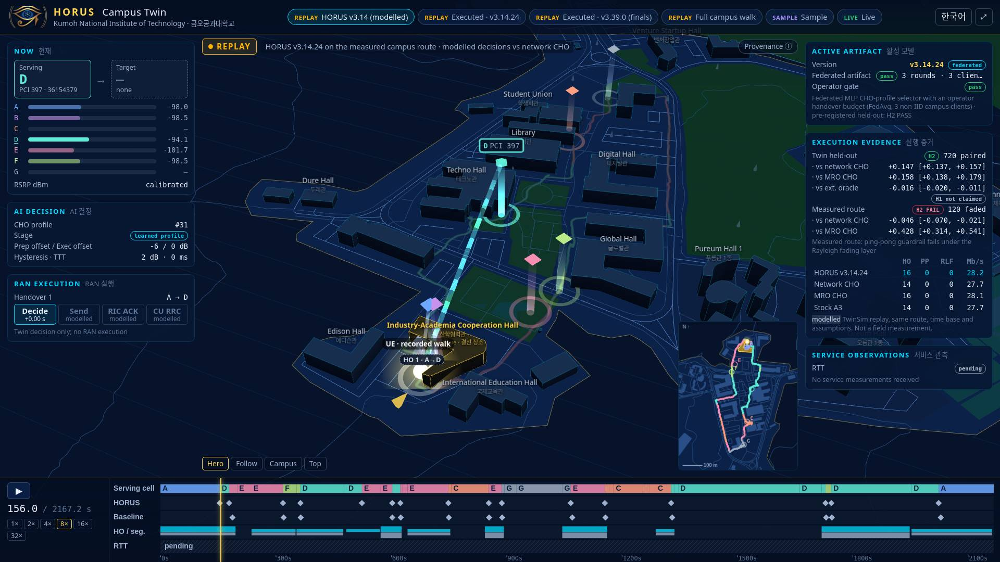
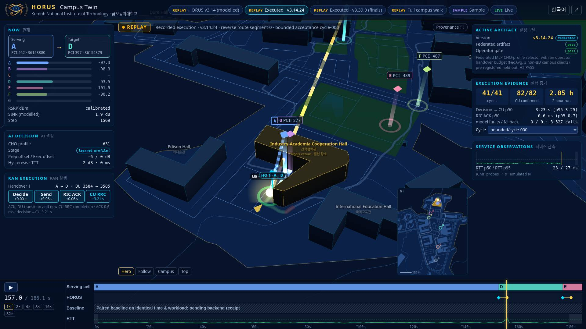

# HORUS: federated AI handover control for campus 5G

For every UE, HORUS continuously picks the conditional-handover (CHO) profile the RAN should use.
The policy is learned **federatedly** across campus networks. A safety gate admits a model only if it improves
the network without regressing failures. In our tests the gate promoted every clean candidate and rejected a
poisoned FedAvg update.
The policy runs as an **online runtime** that issues real handovers on an OAI 5G RAN. It was built at Kumoh
National Institute of Technology (금오공과대학교) for Track 2 of the 2026 이음5G+ × AI Smart Campus Challenge.



## See it: the 3D campus console

```bash
python3 dashboard/campus3d/serve.py          # then open http://127.0.0.1:8030/campus3d/
```

The console needs no install and no network: the server uses only the Python standard library, and three.js
is bundled. It runs in English and Korean (`L` switches).

| Scenario (top bar) | What you are looking at |
|---|---|
| **HORUS v3.14 (modelled)**, the default | The frozen model `v3.14.24` driving a UE along the measured 36-minute campus walk route. The comparison arms are network-wide CHO, MRO CHO and stock A3, all on the same calibrated radio surface. The right panel holds the pre-registered results, failures included. |
| **Executed · v3.14.24** | The same model **running live**. The calibrated route feeds the online runtime, and its decisions become OAI F1 handovers between two DUs, confirmed by the CU. Pick any of the 41 cycles of the two-hour acceptance run. For each handover the console shows decide → send → RIC ACK → CU RRC complete. |
| **Executed · v3.39.0 (finals)** | The live path with the model that ran at the competition finals: 72 CU-confirmed handovers over two hours. |
| **Full campus walk** | The measured walk: the operator's own serving cells and the 38 cell changes it actually made, with HORUS and the baselines replayed on the calibrated surface. |
| **Live** | Attaches to a running `release/run_demo.py` capture (`serve.py --capture DIR`). It shows WAITING or STALE rather than falling back to recorded data. |



## Results

Every confirmatory number below was produced by a single pre-registered run. The rules, seeds, thresholds and
tie-breaks were fixed in `pipeline/finals_preregistration_v3_14.json` before any held-out episode was simulated.
The candidate was frozen in `working/evidence/v3.14/FREEZE.md`. All pre-registered tests are reported, including the
ones that failed.

**1. Held-out twin test (720 paired episodes: 4 mobility scenarios × 3 fading models × 60 unseen seeds): H2 PASS.**
Utility per UE-minute is 60·SE/7.4 − 0.3·HO − 2·ping-pong − 5·(RLF+HOF). Each difference is paired on identical
radio traces and reported with its 95% CI.

| HORUS v3.14.24 minus | utility [95% CI] | handovers / UE-min | verdict |
|---|---|---|---|
| Network-wide tuned CHO (= 3GPP mobility-state CHO) | **+0.147 [+0.137, +0.157]** | −0.141 | PASS |
| MRO-adaptive CHO | **+0.158 [+0.138, +0.179]** | −0.535 | PASS |
| Network-wide tuned A3 | **+1.433 [+1.158, +1.709]** | −2.156 | PASS |
| Per-cell best-tuned A3 (oracle) | +0.226 [+0.197, +0.255] | −0.925 | pass |
| Per-cell best-tuned CHO (oracle) | +0.009 [+0.003, +0.016] | −0.351 | pass |
| Per-cell best CHO, extended grid (oracle) | −0.016 [−0.020, −0.011] | −0.203 | **fail**: H1 not claimed |

HORUS makes fewer handovers than every baseline and regresses no failure guardrail against any deployable one.
The utility CIs against the deployable baselines stay above zero at 97.5% (Bonferroni across the two
confirmatory files). Of the oracles, it beats both per-cell tuned A3 and per-cell tuned CHO. The only one it does
not beat is the extended per-cell CHO grid, an exhaustive per-cell search that an operator cannot deploy.

**2. Safety gate and poisoning.** The gate is run twice, on unchanged seeds 1100..1102 and on replicate seeds
1300..1302. It promotes every clean federated candidate (score 0.80 / 0.82). It rejects the poisoned-FedAvg
candidate under both seed sets (0.50 / 0.51; that candidate makes 8.4 handovers per minute). Coordinate-median
aggregation absorbs the poisoned client.

**3. Live on a 5G RAN: two-hour acceptance PASS.** v3.14.24 ran in the online runtime with its decisions executed
as OAI F1 handovers (emulated RF):

| | |
|---|---|
| AI handovers ACKed and CU-confirmed | **82 / 82**, 0 failed, 41/41 cycles |
| Online inferences | 3,527, with 0 model faults, 0 fallback and 0 invalid frames |
| Real sustained time | **7,380.8 s** (UTC, independently cross-checked) |
| Decision → CU RRC complete | 3.23 s median; RIC ACK 0.6 ms median |
| Source integrity | 5,040 source files re-hashed after the run, all match |

Before going live, the runtime reproduced the offline selector frame for frame: 20,169 frames and 899 inference
calls, 0 faults (`working/evidence/selector-integration-v3.14/`).

**4. Measured campus route (transfer test, frozen model, no retraining): H2 FAIL vs network CHO.**
Over 120 faded episodes on the calibrated walk route, HORUS beats MRO CHO by +0.428 [+0.314, +0.541] and stock
A3 by +2.688 [+2.241, +3.135]. It loses to network-wide CHO by −0.046 [−0.070, −0.021], and the ping-pong
guardrail fails under the Rayleigh fading layer. The console shows this result next to the passes.

**Pre-registered confirmatory tests so far:**

| Candidate | Test | Verdict |
|---|---|---|
| v3.1.1 (finals) | twin held-out, seeds 2100..2119 | NO-GO |
| **v3.14.24** | twin held-out, seeds 2200..2259 | **H2 PASS**, H1 fail |
| v3.14.32 (utility-only rule) | twin held-out, seeds 2300..2359 | NO-GO |
| **v3.14.24** | measured campus route | H2 FAIL vs network CHO |

## Check it yourself

```bash
python3 verify.py
```

`verify.py` uses only the Python standard library and finishes in seconds. It recomputes the claims from the raw
evidence rather than from summary files:

- the model's weights hash and the pre-registration hash match the freeze record;
- the held-out table is recomputed from the 7,200 raw episode rows;
- the measured-route numbers are recomputed from that test's raw rows;
- the live result is re-aggregated from the 41 per-cycle driver summaries;
- the numbers the console shows match all of the above.

Running the full code needs Python 3.12 (`pip install -r requirements.txt`; torch CPU wheels):

```bash
make test                                   # runtime contract, v3.14 pipeline, console and dashboard tests
cd pipeline && python -m twin.evaluate_v3 --v3 v3.14.24 --seed0 2200 --seeds 60 --workers 15 --final \
    --prereg finals_preregistration_v3_14.json --out /tmp/heldout-rerun     # re-simulate all 7,200 episodes
```

The run takes a few minutes on 16 threads and also rewrites `working/evidence/finals-results-v3.14.json`. We did
exactly this on this release (`working/evidence/finals-v3.14/rerun-release-code/`). 7,120 of the 7,200 rows are
identical. The other 80 differ only in short-stay and ping-pong counts, because of a ping-pong float-boundary fix
merged after the confirmatory run. Two numbers move in the fourth decimal (MRO +0.15839 → +0.15836, A3
+1.43343 → +1.43317), and every verdict is identical. `verify.py` checks this too.

`release/run_demo.py --live` runs the live acceptance. It needs the OAI images built from `stack/oai-ho/*/Dockerfile`
and a Linux or WSL host with Docker; see `stack/SELECTOR_RUNTIME.md`.

## How it works

| Piece | Code |
|---|---|
| Digital twin: OpenCelliD campus cell map, 3GPP channel and PHY abstraction, A3/CHO/MRO baselines | `pipeline/twin/sim.py`, `phy.py`, `controllers_v2.py`, `scenarios.py` |
| Selector: per-UE MLP with trend features and three prediction heads (utility, HO rate, failures), operator HO budget | `pipeline/twin/cho_v3.py`, `selector_v3.py` |
| Federated training: FedProx/FedAvg/median over three non-IID campus clients | `pipeline/twin/train_v314.py`, `fed_v3.py` |
| Safety gate | `pipeline/twin/gate_v3.py`, `pipeline/gate_config_finals*.json` |
| Pre-registered evaluation | `pipeline/twin/run_v314.py`, `evaluate_v3.py`, `measured_v314.py` |
| Online runtime: validated model contract, frame-by-frame parity, fail-safe fallback to A3 | `stack/selector_runtime.py`, `release/selector_integration_v314.py` |
| Live path: replay producer → runtime → FlexRIC xApp → OAI CU/DU | `stack/measured_selector_stream.py`, `stack/oai-ho/`, `release/run_demo.py` |
| 3D console | `dashboard/campus3d/` (README inside) |

Evidence lives in `working/evidence/`. `RESULTS-v3.14-v3.15.md` explains it; the raw rows are in `finals-v3.14/`,
`measured-v3.14/` and `live-v3.14/`. The frozen candidates are in `working/candidates/` and their weights in
`pipeline/checkpoints/`.

## Scope

- The twin results are modelled: simulated radio on a real campus cell map, with the RSRP surface calibrated from
  a measured walk.
- The live results use the OAI RF simulator with ordinary F1 handovers. CHO profiles execute in the twin. It is not
  a field RAN and not native RRC CHO.
- The walk trace itself (GPS positions and times of a team member) is not published. The calibrated route surfaces
  and every result derived from the trace are included. Re-running the measured-route test and rebuilding the
  console's route need the trace.
- This repository is a curated release of a private project repository.

## License

Apache-2.0 (`LICENSE`). OpenCelliD-derived data is CC BY-SA 4.0, and the OpenStreetMap snapshot is ODbL; see
`NOTICE.md`. three.js is MIT (`dashboard/campus3d/vendor/LICENSE-three.txt`).
